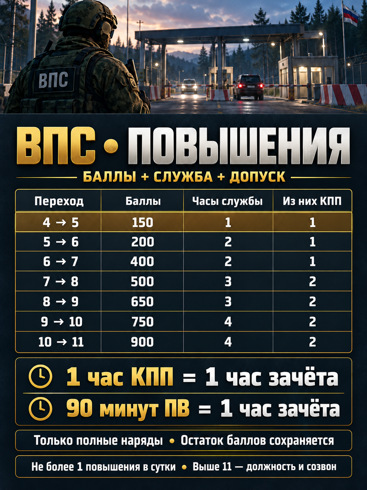
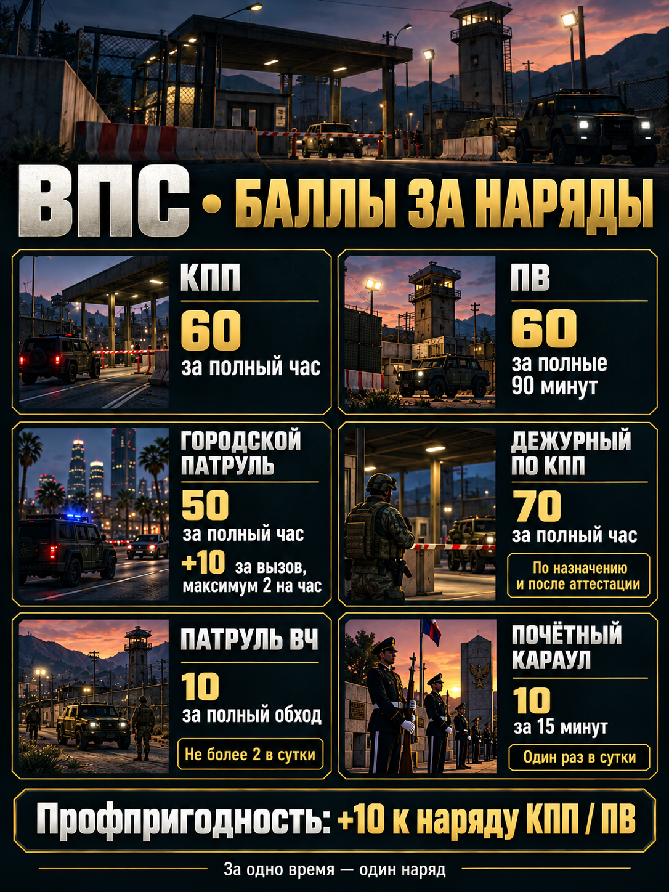
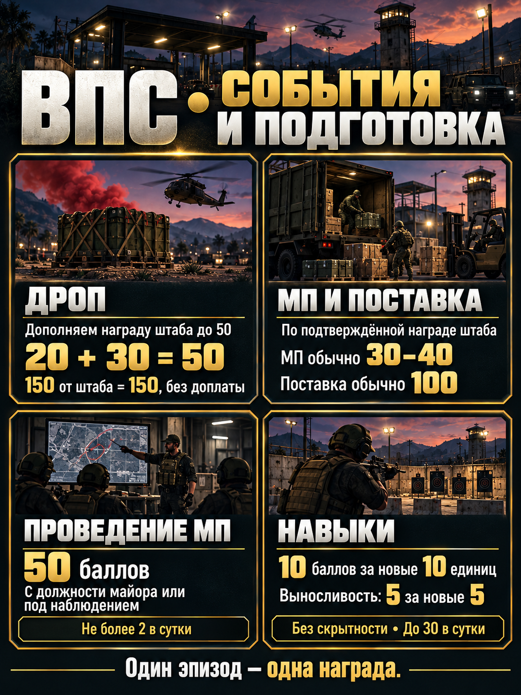
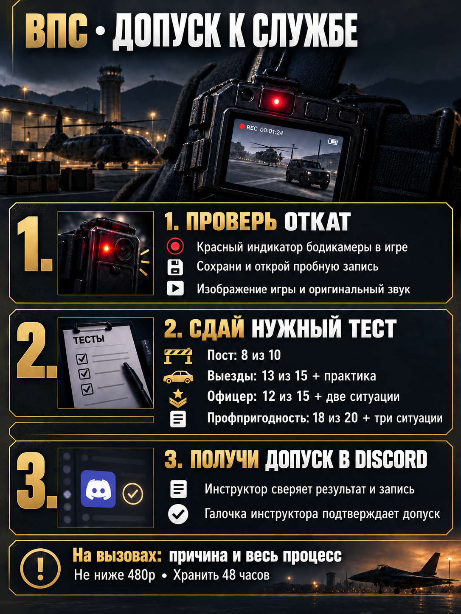

# ВПС — повышения, наряды и обучение

**Баллы + обязательная служба + проверенные знания.** Редакция от 18.10.2026 с последними поправками. Это предложение для утверждения руководством; дата запуска объявляется отдельно. Исходные игровые законы не изменены.

**[Скачать весь комплект ZIP](https://github.com/NeSmotriNaManay/kutuzovsky-rp-laws/raw/refs/heads/main/vps/downloads/%D0%92%D0%9F%D0%A1%20-%20%D0%BF%D0%BE%D0%BB%D0%BD%D1%8B%D0%B9%20%D0%BA%D0%BE%D0%BC%D0%BF%D0%BB%D0%B5%D0%BA%D1%82.zip)** · [Краткая памятка](%D0%9F%D0%B0%D0%BC%D1%8F%D1%82%D0%BA%D0%B0%20%D1%81%D0%BE%D0%BB%D0%B4%D0%B0%D1%82%D1%83.md) · [Полный регламент](regulation.md) · [Расчёт баланса](balance.md)

## Скачать тесты и материалы

PDF можно сохранить с открывшейся страницы. В текстовых версиях удобно искать и копировать вопросы в конструктор тестов.

| Комплект | Скачать PDF | Читать / копировать |
|---|---|---|
| Тесты патруля — 30 вопросов с ответами | [Скачать](https://github.com/NeSmotriNaManay/kutuzovsky-rp-laws/raw/refs/heads/main/vps/downloads/%D0%A2%D0%B5%D1%81%D1%82%20%D0%BF%D0%B0%D1%82%D1%80%D1%83%D0%BB%D1%8F.pdf) | [Открыть текст](%D0%A2%D0%B5%D1%81%D1%82%20%D0%BF%D0%B0%D1%82%D1%80%D1%83%D0%BB%D1%8F.md) |
| Материалы для изучения — патруль | [Скачать](https://github.com/NeSmotriNaManay/kutuzovsky-rp-laws/raw/refs/heads/main/vps/downloads/%D0%9C%D0%B0%D1%82%D0%B5%D1%80%D0%B8%D0%B0%D0%BB%D1%8B%20%D0%B4%D0%BB%D1%8F%20%D0%BF%D0%B0%D1%82%D1%80%D1%83%D0%BB%D1%8F.pdf) | [Открыть текст](%D0%9C%D0%B0%D1%82%D0%B5%D1%80%D0%B8%D0%B0%D0%BB%D1%8B%20%D0%B4%D0%BB%D1%8F%20%D0%BF%D0%B0%D1%82%D1%80%D1%83%D0%BB%D1%8F.md) |
| Тесты офицеров — 30 вопросов с ответами | [Скачать](https://github.com/NeSmotriNaManay/kutuzovsky-rp-laws/raw/refs/heads/main/vps/downloads/%D0%A2%D0%B5%D1%81%D1%82%20%D0%BE%D1%84%D0%B8%D1%86%D0%B5%D1%80%D0%B0.pdf) | [Открыть текст](%D0%A2%D0%B5%D1%81%D1%82%20%D0%BE%D1%84%D0%B8%D1%86%D0%B5%D1%80%D0%B0.md) |
| Материалы для изучения — офицер | [Скачать](https://github.com/NeSmotriNaManay/kutuzovsky-rp-laws/raw/refs/heads/main/vps/downloads/%D0%9C%D0%B0%D1%82%D0%B5%D1%80%D0%B8%D0%B0%D0%BB%D1%8B%20%D0%B4%D0%BB%D1%8F%20%D0%BE%D1%84%D0%B8%D1%86%D0%B5%D1%80%D0%B0.pdf) | [Открыть текст](%D0%9C%D0%B0%D1%82%D0%B5%D1%80%D0%B8%D0%B0%D0%BB%D1%8B%20%D0%B4%D0%BB%D1%8F%20%D0%BE%D1%84%D0%B8%D1%86%D0%B5%D1%80%D0%B0.md) |
| Профпригодность — 24 вопроса с ответами | [Скачать](https://github.com/NeSmotriNaManay/kutuzovsky-rp-laws/raw/refs/heads/main/vps/downloads/%D0%A2%D0%B5%D1%81%D1%82%20%D0%BF%D1%80%D0%BE%D1%84%D0%BF%D1%80%D0%B8%D0%B3%D0%BE%D0%B4%D0%BD%D0%BE%D1%81%D1%82%D0%B8.pdf) | [Открыть текст](%D0%A2%D0%B5%D1%81%D1%82%20%D0%BF%D1%80%D0%BE%D1%84%D0%BF%D1%80%D0%B8%D0%B3%D0%BE%D0%B4%D0%BD%D0%BE%D1%81%D1%82%D0%B8.md) |
| Материалы для изучения — профпригодность | [Скачать](https://github.com/NeSmotriNaManay/kutuzovsky-rp-laws/raw/refs/heads/main/vps/downloads/%D0%9C%D0%B0%D1%82%D0%B5%D1%80%D0%B8%D0%B0%D0%BB%D1%8B%20%D0%BF%D0%BE%20%D0%BF%D1%80%D0%BE%D1%84%D0%BF%D1%80%D0%B8%D0%B3%D0%BE%D0%B4%D0%BD%D0%BE%D1%81%D1%82%D0%B8.pdf) | [Открыть текст](%D0%9C%D0%B0%D1%82%D0%B5%D1%80%D0%B8%D0%B0%D0%BB%D1%8B%20%D0%BF%D0%BE%20%D0%BF%D1%80%D0%BE%D1%84%D0%BF%D1%80%D0%B8%D0%B3%D0%BE%D0%B4%D0%BD%D0%BE%D1%81%D1%82%D0%B8.md) |
| Памятка солдату — одна страница | [Скачать](https://github.com/NeSmotriNaManay/kutuzovsky-rp-laws/raw/refs/heads/main/vps/downloads/%D0%9F%D0%B0%D0%BC%D1%8F%D1%82%D0%BA%D0%B0%20%D1%81%D0%BE%D0%BB%D0%B4%D0%B0%D1%82%D1%83.pdf) | [Открыть текст](%D0%9F%D0%B0%D0%BC%D1%8F%D1%82%D0%BA%D0%B0%20%D1%81%D0%BE%D0%BB%D0%B4%D0%B0%D1%82%D1%83.md) |
| Руководство: регламент, проверки, устные сценки, отчёты | [Скачать](https://github.com/NeSmotriNaManay/kutuzovsky-rp-laws/raw/refs/heads/main/vps/downloads/%D0%A0%D1%83%D0%BA%D0%BE%D0%B2%D0%BE%D0%B4%D1%81%D1%82%D0%B2%D0%BE%20%D0%92%D0%9F%D0%A1.pdf) | [Открыть текст](%D0%A0%D1%83%D0%BA%D0%BE%D0%B2%D0%BE%D0%B4%D1%81%D1%82%D0%B2%D0%BE%20%D0%92%D0%9F%D0%A1.md) |
| Тест дежурного по КПП | [Скачать PDF](https://github.com/NeSmotriNaManay/kutuzovsky-rp-laws/raw/refs/heads/main/vps/downloads/%D0%A2%D0%B5%D1%81%D1%82%20%D0%B4%D0%B5%D0%B6%D1%83%D1%80%D0%BD%D0%BE%D0%B3%D0%BE%20%D0%BF%D0%BE%20%D0%9A%D0%9F%D0%9F.pdf) | [Читать](%D0%A2%D0%B5%D1%81%D1%82%20%D0%B4%D0%B5%D0%B6%D1%83%D1%80%D0%BD%D0%BE%D0%B3%D0%BE%20%D0%BF%D0%BE%20%D0%9A%D0%9F%D0%9F.md) |
| Материалы для дежурного по КПП | [Скачать PDF](https://github.com/NeSmotriNaManay/kutuzovsky-rp-laws/raw/refs/heads/main/vps/downloads/%D0%9C%D0%B0%D1%82%D0%B5%D1%80%D0%B8%D0%B0%D0%BB%D1%8B%20%D0%B4%D0%BB%D1%8F%20%D0%B4%D0%B5%D0%B6%D1%83%D1%80%D0%BD%D0%BE%D0%B3%D0%BE%20%D0%BF%D0%BE%20%D0%9A%D0%9F%D0%9F.pdf) | [Читать](%D0%9C%D0%B0%D1%82%D0%B5%D1%80%D0%B8%D0%B0%D0%BB%D1%8B%20%D0%B4%D0%BB%D1%8F%20%D0%B4%D0%B5%D0%B6%D1%83%D1%80%D0%BD%D0%BE%D0%B3%D0%BE%20%D0%BF%D0%BE%20%D0%9A%D0%9F%D0%9F.md) |
| Устный экзамен дежурного по КПП | [Скачать PDF](https://github.com/NeSmotriNaManay/kutuzovsky-rp-laws/raw/refs/heads/main/vps/downloads/%D0%A3%D1%81%D1%82%D0%BD%D1%8B%D0%B9%20%D1%8D%D0%BA%D0%B7%D0%B0%D0%BC%D0%B5%D0%BD%20%D0%B4%D0%B5%D0%B6%D1%83%D1%80%D0%BD%D0%BE%D0%B3%D0%BE%20%D0%BF%D0%BE%20%D0%9A%D0%9F%D0%9F.pdf) | [Читать](%D0%A3%D1%81%D1%82%D0%BD%D1%8B%D0%B9%20%D1%8D%D0%BA%D0%B7%D0%B0%D0%BC%D0%B5%D0%BD%20%D0%B4%D0%B5%D0%B6%D1%83%D1%80%D0%BD%D0%BE%D0%B3%D0%BE%20%D0%BF%D0%BE%20%D0%9A%D0%9F%D0%9F.md) |

**Отдельно:** [три устные ситуации профпригодности](%D0%A3%D1%81%D1%82%D0%BD%D1%8B%D0%B5%20%D1%81%D0%B8%D1%82%D1%83%D0%B0%D1%86%D0%B8%D0%B8%20%D0%BF%D1%80%D0%BE%D1%84%D0%BF%D1%80%D0%B8%D0%B3%D0%BE%D0%B4%D0%BD%D0%BE%D1%81%D1%82%D0%B8.md) · [формы Discord](reports.md) · [настройки и порядок всех аттестаций](%D0%9F%D0%BE%D1%80%D1%8F%D0%B4%D0%BE%D0%BA%20%D0%BF%D1%80%D0%BE%D0%B2%D0%B5%D0%B4%D0%B5%D0%BD%D0%B8%D1%8F%20%D1%82%D0%B5%D1%81%D1%82%D0%BE%D0%B2.md) · [предлагаемый порядок выездов](dispatch.md).

Для будущего бота/переноса: [патруль JSON](%D0%91%D0%B0%D0%BD%D0%BA%20%D0%B2%D0%BE%D0%BF%D1%80%D0%BE%D1%81%D0%BE%D0%B2%20%D0%BF%D0%B0%D1%82%D1%80%D1%83%D0%BB%D1%8F.json), [офицер JSON](%D0%91%D0%B0%D0%BD%D0%BA%20%D0%B2%D0%BE%D0%BF%D1%80%D0%BE%D1%81%D0%BE%D0%B2%20%D0%BE%D1%84%D0%B8%D1%86%D0%B5%D1%80%D0%B0.json), [профпригодность JSON](%D0%91%D0%B0%D0%BD%D0%BA%20%D0%B2%D0%BE%D0%BF%D1%80%D0%BE%D1%81%D0%BE%D0%B2%20%D0%BF%D1%80%D0%BE%D1%84%D0%BF%D1%80%D0%B8%D0%B3%D0%BE%D0%B4%D0%BD%D0%BE%D1%81%D1%82%D0%B8.json). Это структурированные банки, не заявленный штатный формат импорта Online Test Pad. Тесты в аккаунте сервиса автоматически не созданы.

## Дежурный по КПП

[Отдельный тест: 10 вопросов с ответами](%D0%A2%D0%B5%D1%81%D1%82%20%D0%B4%D0%B5%D0%B6%D1%83%D1%80%D0%BD%D0%BE%D0%B3%D0%BE%20%D0%BF%D0%BE%20%D0%9A%D0%9F%D0%9F.md) · [Материалы для подготовки](%D0%9C%D0%B0%D1%82%D0%B5%D1%80%D0%B8%D0%B0%D0%BB%D1%8B%20%D0%B4%D0%BB%D1%8F%20%D0%B4%D0%B5%D0%B6%D1%83%D1%80%D0%BD%D0%BE%D0%B3%D0%BE%20%D0%BF%D0%BE%20%D0%9A%D0%9F%D0%9F.md) · [Банк вопросов JSON](%D0%91%D0%B0%D0%BD%D0%BA%20%D0%B2%D0%BE%D0%BF%D1%80%D0%BE%D1%81%D0%BE%D0%B2%20%D0%B4%D0%B5%D0%B6%D1%83%D1%80%D0%BD%D0%BE%D0%B3%D0%BE%20%D0%BF%D0%BE%20%D0%9A%D0%9F%D0%9F.json). Тест, материалы и устные ситуации доступны для чтения и скачивания; входят в общий ZIP. Это подборка из офицерского банка, а не 10 новых уникальных вопросов.

## Что изменилось

- КПП — **60 за полный непрерывный час**, ПВ — **60 за полные 90 минут**. Короткие раздельные выходы не суммируются. Доклады каждые 15 минут остаются контролем, не единицей оплаты.
- ПВ дают час зачёта за 90 минут, но минимальный КПП в таблице обязателен. Цены повышения сохранены: 150 / 200 / 400 / 500 / 650 / 750 / 900.
- Дроп — награда штаба с **доплатой до 50**, а не ещё 50 сверху. 20 + 30 = 50; 150 от штаба остаются 150.
- МП и поставки учитываются по подтверждённой награде штаба. Проведение полезного МП — 50, с должности майора либо под наблюдением.
- Добровольная профпригодность с 6-го ранга: **18/20 + три устные ситуации + откат**. Награда — +10 к следующим полным нарядам КПП/ПВ.
- Остаток баллов сохраняется, недельного сгорания нет; не чаще одного повышения за календарные сутки МСК. Выше 11-го — должность и созвон.

## Карточки для Discord

Открой нужную картинку и сохрани оригинал. Картинки — краткая памятка; полный порядок, ограничения и дата начала действия задаются регламентом.

| Повышения | Наряды |
|---|---|
|  |  |

| События и подготовка | Допуски |
|---|---|
|  |  |

## Как проводить проверки

| Проверка | Онлайн | Практика |
|---|---|---|
| Базовый постовой допуск | 8/10 в ранее созданном тесте | Реальный сохранённый откат |
| Средний состав, 6 → 7 | 8/10, подборка офицерского банка | Доклад и пропускная ситуация |
| Городские выезды | 13/15, 15 минут | Три ситуации, учебная отработка, откат |
| Офицер, 8 → 9 | 12/15, 15 минут | Две ситуации, проверенная запись |
| Дежурный по КПП, с 7-го | 8/10, отдельная подборка | Три ситуации, проверка отката, назначение на смену |
| Профпригодность, с 6-го | 18/20, 20 минут | Три ситуации: от 4/5 каждая, от 13/15 суммарно |

Банки публичны для подготовки. Онлайн-балл не доказывает самостоятельность; инструктор сверяет личность/попытку, проверяет понимание и откат. ✅ ставится после всех этапов. Ответы и личные записи — разные вещи: записи участников не публикуются в этой библиотеке.

## Перед запуском

Руководству остаётся объявить регламент, проверяющих и дату начала. Для регулярных городских выездов нужен законный порядок участия ВС: сейчас, по уточнению пользователя, утверждённого порядка нет. Внутренний тест не создаёт полномочий полиции. Специальные правила событий сверяются отдельно.

Расчётный насыщенный профиль даёт повышение за 1–3 дня; при умеренной активности поздняя ступень может занять 4 дня. Это сценарий, не обещание за сам факт онлайна. [Расчёты и пилот](balance.md).

[Источники и состав комплекта](sources.md) · [История изменений](CHANGELOG.md) · [Основная библиотека игровых правил](../README.md).

## Как пользоваться библиотекой

**Читать:** выбирайте «Открыть текст» или «Читать» в таблице. **Скачать:** выбирайте PDF или общий ZIP в начале страницы. Для доступа к публичным материалам аккаунт GitHub не нужен.

В комплекте дежурного: онлайн-тест 8/10, три устных кейса, критерии оценки и проверка отката. PDF руководства обновлён и включает все три кейса. Для экзаменов на сайте используются отдельные формы: файлы этой библиотеки сами по себе не создают тест в Online Test Pad.
